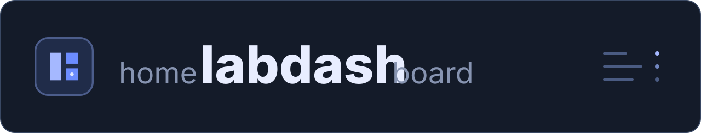
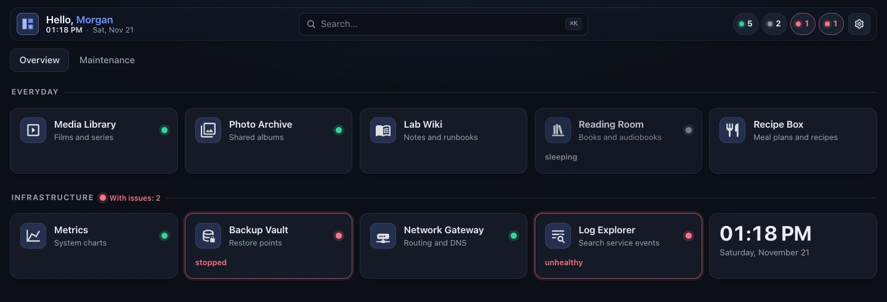

> [!NOTE]
> **Yes, I know – another dashboard.** I built labdash for my own homelab,
> especially because I wanted a faster-loading alternative to Homepage and a
> few features for my setup. It may not be for everyone, but feature requests
> and pull requests are welcome, including for features I may not use myself.

labdash is a self-hosted dashboard for links, clocks and Docker containers.
Organize tiles into pages and groups; container status updates live. Docker is
optional, and the server is a single Go executable with no database.



*Demo dashboard. All service names, addresses, and container data shown are sample data.*

## Quickstart

1. Download [compose.yaml](compose.yaml) into an empty folder.
2. Create a `.env` file next to it:

   ```dotenv
   LABDASH_AUTH_PASSWORD=replace-with-a-strong-password
   LABDASH_SESSION_SECRET=replace-with-a-random-secret
   ```

   Generate a session secret with `openssl rand -hex 32`, replace the example
   value, and keep `.env` private (`chmod 600 .env`).
3. Start labdash and check that it is healthy:

   ```sh
   docker compose up -d
   curl -fsS http://127.0.0.1:8080/healthz
   ```

Open [http://127.0.0.1:8080](http://127.0.0.1:8080) and sign in. The example
Compose file listens on localhost only; configure HTTPS before exposing
labdash beyond your machine. See [Security](SECURITY.md).

On first use, choose a dashboard name and theme or skip setup. To edit tiles,
open **Settings → Edit dashboard**. Pages separate collections of groups and
tiles; search filters tiles on the current page. The interface supports
English and German.

The Compose file uses the `1.0.0` image. The `1.0`, `1` and `latest` tags track
newer releases. Layout data is stored in the `labdash-data` volume. Back it up
before upgrading; `docker compose down -v` deletes it.

## Optional Docker integration

Docker integration is disabled in the Quickstart. To discover containers,
mount the Docker socket. Docker access is powerful:
**a read-only socket mount does not make the Docker API read-only.** Review
[Security](SECURITY.md) before enabling it.

<details>
<summary>Docker discovery, labels, and container links</summary>

Mount `/var/run/docker.sock:/var/run/docker.sock:ro` and remove
`LABDASH_DOCKER_SOCKET: "off"` from the Compose file. The default socket path
inside the container is `/var/run/docker.sock`; set `LABDASH_DOCKER_SOCKET`
if you mount it elsewhere. Rootless Docker can use a different host socket.

Add labels to a service to create a dashboard tile:

```yaml
labels:
  labdash.name: "Media library"
  labdash.group: "Media"
  labdash.href: "https://media.example.org"
  labdash.icon: "jellyfin"
```

A name or link is enough. Tiles join groups by title, and new groups appear on
the first page. `javascript:` and similar unsafe links are ignored.

Homepage label discovery is off by default, including after an upgrade. Enable
**Settings → Edit dashboard → Docker discovery → Discover from Homepage
labels**, then select **Done** and **Save**.

To customize a discovered tile, pin it in edit mode; the saved tile then takes
precedence over automatic discovery. You can also add a tile manually with
**Tile** in the edit toolbar or **Add tile** in a group.

To open a problem container in Arcane or another container manager, set
`LABDASH_CONTAINER_LINK` to an absolute HTTP(S) URL. The template supports
`{id}`, `{name}` and `{project}`. For Arcane's local Docker environment:

```text
https://arcane.example.org/containers/{id}?env=0
```

The link is shown for problem containers on their tile and in the status
dialog, and only to signed-in users. Container start, stop and restart actions
are disabled by default; enabling them requires password authentication.

</details>

## Tile icons

Use an icon name such as `jellyfin` from
[Dashboard Icons](https://github.com/homarr-labs/dashboard-icons) or `mdi-home`
from [Material Design Icons](https://pictogrammers.com/library/mdi/). Without
a matching icon, the tile shows the initials of its name.

<details>
<summary>Icon sources and fully offline setup</summary>

Icons are resolved in this order:

1. Your images in `/data/icons` (`LABDASH_ICONS`), for example
   `/data/icons/jellyfin.svg`.
2. Previously downloaded icons in `/data/icon-cache` (`LABDASH_ICON_CACHE`).
3. By default, a one-time server download from Dashboard Icons or Material
   Design Icons via jsDelivr. Downloaded icons are cached.

The browser loads dashboard assets from labdash and never contacts jsDelivr.
To disable outbound icon downloads, set `LABDASH_ICON_DOWNLOAD=false`; existing
cached or local icons will still work. Without internet access, use your own
icons or previously cached ones. Supported image extensions are `.svg`, `.png`,
`.webp`, `.jpg`, `.jpeg`, `.gif`, `.ico` and `.avif`; icons are limited to
2 MiB. Check the collections' license and trademark notes.

</details>

## Server settings

<details>
<summary>Environment variables and defaults</summary>

| Variable | Default | Purpose |
| --- | --- | --- |
| `LABDASH_PORT` | `8080` | HTTP port inside the container |
| `LABDASH_CONFIG` | `/data/config.json` | Writable JSON layout file |
| `LABDASH_TITLE` | `labdash` | Login title; dashboard title is editable in the layout |
| `LABDASH_AUTH` | `password` | `password` or `none`; without auth, anyone who can reach the server can edit the layout |
| `LABDASH_AUTH_PASSWORD` | unset | Required in password mode |
| `LABDASH_SESSION_SECRET` | random per start | Stable signing key to keep sessions across restarts |
| `LABDASH_SECURE_COOKIE` | `true` | Require HTTPS for the session cookie |
| `LABDASH_TRUSTED_PROXIES` | unset | IPs or CIDR ranges of trusted reverse proxies |
| `LABDASH_ICONS` | `/data/icons` | Folder with your own tile images |
| `LABDASH_ICON_DOWNLOAD` | `true` | Download missing icons once |
| `LABDASH_ICON_CACHE` | `/data/icon-cache` | Writable folder for downloaded icons |
| `LABDASH_DOCKER_SOCKET` | `/var/run/docker.sock` | Unix socket path, or `off` |
| `LABDASH_DOCKER_POLL` | `15s` | Docker refresh interval; must be positive |
| `LABDASH_ALLOW_CONTAINER_ACTIONS` | `false` | Allow start, stop and restart; requires Docker and password auth |
| `LABDASH_CONTAINER_LINK` | unset | URL template for problem-container links |
| `LABDASH_LOG_LEVEL` | `info` | `debug`, `info`, `warn` or `error` |

Switches accept `true`/`false`, `1`/`0`, `yes`/`no` and `on`/`off`. Invalid
values and non-positive durations prevent startup with an error naming the
variable.

</details>

For source builds, tests and dependency checks, see [Contributing](CONTRIBUTING.md).

## License

See the [GNU General Public License, version 3](LICENSE).
